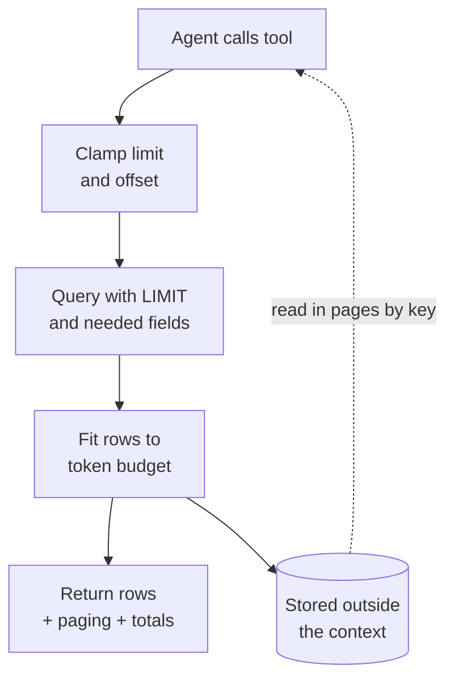

<!-- TODO before publishing: remove `published: false`, add header image, re-read the "What's Measured" section. -->
<!--
{:refdef: style="text-align: center;"}
{: loading="lazy"}
{: refdef} -->

---

> _Disclaimer: AI-assisted editing and structure. The incident, technical decisions, analysis, and opinions are mine. The domain, tables, SQL and code below are invented (an online store) so nothing here points at a real system. The measurements from the incident are real._

---

A user opened a chat with our AI agent, asked a follow-up question, and got an error two seconds later. Two seconds. That was not a timeout, that was the system slamming the door on the users face.

I went to opensearch expecting a crash from the logs and found nothing of the sort. Turn one ran for 8 minutes 39 seconds, made 15 LLM calls and 24 tool calls, and finished with zero errors. Turn two died about two seconds after its model call started. The one number I could pull from that turn was its context size: **463,976 tokens.** *(Yes, that is a lot of tokens. No, I did not type that much.)*

That number is where this story starts, not where it ends. I could show how the context grew. I couldn't show that it killed turn two. The last section says what I have and what I don't. *(The logs also didn't say much about exceptions in general. That's a different post.)*

---

## TL;DR

The tool was correct. The design around it was not. A deterministic function returned exactly what it was asked for, and nothing at the boundary to the model said how much was too much.

- A tool call that returned in **0.10 seconds** took a specialist agent's context from 5.5k to 186k tokens. Another agent went from 10k to as high as 224k after six parallel tool calls.
- My first guard counted **rows** (200 max). Each row was about 900 tokens, so one call put roughly 180k tokens into context and the guard never fired. Every later LLM call in that turn re-sent it.
- Cap by **tokens, not rows**, after the page size. A cap that is strong but not hard: one row bigger than the budget still goes out, so the tool must handle that row itself.
- Don't let the model add up numbers. Compute exact totals in code.
- My guard was opt-in per tool, which means it **fails open**. That is the weakest part of what I built.

---

## The Story

{:refdef: style="text-align: center;"}
{: loading="lazy"}
{: refdef}

The setup: a multi-agent system built on [Google ADK](https://google.github.io/adk-docs/), running Claude on AWS Bedrock through LiteLLM. An orchestrator hands the turn to a specialist agent. The specialist calls tools, reads the results, and writes an answer back.

A tool's return value becomes a `function_response` event in the session. The next model call is built from the session's events, so that result is in the prompt for every later call in the same turn. The tool's job ends at the return. Its output does not.

I pulled up the token metrics and found two things that made me put my coffee down:

| Specialist | Context before | Context at peak | What drove it |
|---|---|---|---|
| Order history | 5.5k tokens | **186k tokens** | One tool call, 0.10 seconds |
| Shipping | 10k tokens | **224k tokens** | Six parallel tool calls |

The tool was fast. It also returned a *lot* of rows, very quickly.

Nothing was slow. Nothing errored. Every row was correct. The tool did what its docstring promised: "return the customer's orders". The customer just had hundreds of them, and I had never asked what "all the orders" costs when the reader is a language model that re-reads everything on every call.

The wider logs told the same story. Over 7 days of production logs (counts only):

- **17 context failures** across **13 sessions**, all in one agent.
- First failure came on turn 1 for 6 sessions, turn 2 for 3, turn 3 for 2 and turn 4 for 2. "Turn" here means completed responses logged before the failure. I did not verify session start times.
- The context-size figure I logged at failure clustered near **1.4M** and **2.8M** tokens. I have not checked whether that is window size or cumulative input. Treat it as open until I have.

---

## "But I Had a Guard!"

I mean I did. I want that on the record. We have a helper/decorator function that said: *if a tool returns more than 200 rows, truncate and warn.* Responsible adult behaviour right!

A row limit caps rows, not tokens. Illustrative numbers, not measured:

- 200 rows of 5 tokens each: 1,000 tokens. The row guard passes it, and it should.
- 200 rows of 900 tokens each: 180,000 tokens. The row guard also passes it. Same rule, 180 times the cost.

The tool returned fewer than 200 rows. *(Famous last words: "it's capped at 200, what's the worst that could happen?")* Each row carried free-text notes and nested fields, about 900 tokens per row. A single call was roughly 180k tokens, sitting comfortably under a limit that only knew how to count rows. Worse, the helper treated dict-shaped payloads as empty, so those never tripped it at all.

I also assumed history compaction would rescue me. It doesn't. The current setup trims old tool content but keeps the most recent events raw, so a huge result inside the retained window just sits there. Compaction is a late, lossy backstop. It is not a control.

For illustration:

{:refdef: style="text-align: center;"}
{: loading="lazy"}
{: refdef}

---

## The Boundary Nobody Owned

Two kinds of component met in that tool call. The tool is deterministic: same query, same rows, same output every time. The model is probabilistic: it reads whatever arrives and writes the next step from it. Each side did its job. The problem sat in the gap between them.

The tool's contract said "return the customer's orders". It said nothing about size, and the model's contract said nothing about how much input it can take. Neither side owned the number that mattered most, so a single fast call could fill the window and the next call would pay for it again.

I can't prove this shape is common. It is one incident. But any time deterministic output feeds a model, the same gap is there. The controls in this post sit at that boundary:

- **At the source:** the query decides what is fetched.
- **At the boundary:** a wrapper sizes the output, pages it, and reports the total, whatever the tool returned.
- **Outside the context:** the full result lives in a store, and the model holds only a page and a key.

The rest of the post is these three controls, and the reason each one exists.

## Why One Result Costs More Than Once

Two numbers get mixed up here. They are different things.

- **Window occupancy:** how many tokens the model sees on one call. A 15k result adds 15k to it, and it stays until something removes it.
- **Cumulative input:** the sum of input tokens over every call in the turn. Each call re-sends the whole context, so one result is billed once for every later call.

Illustrative numbers, not measured. Assume 5k of history, a 15k tool result that arrives after call 2, and 10 model calls in the turn. Output tokens are left out.

| | Calls 1–2 | Calls 3–10 (8 calls) | Turn total |
|---|---|---|---|
| No big result | 5k each, 10k | 5k each, 40k | 50k input |
| With the 15k result | 5k each, 10k | 20k each, 160k | 170k input |

Occupancy at call 10 goes from 5k to 20k. Cumulative input goes from 50k to 170k. One 15k result adds 120k billed input across the turn.

So a result that arrives on call 2 costs more than the same result on call 14. And the "over 1 million input tokens" figure in the TL;DR is a sum across calls, not a window size.

---

## How ADK Holds the Context

Google ADK keeps each session as a list of **events**. A user message, a model reply, a tool call and a tool result are each one event. Every model call is built from the session's events, so a big tool result stays in the session until something removes it.

- The orchestrator picks which specialist gets the turn. The specialist's tool calls and results are written to the same session.
- A tool result is stored as a `function_response` event.
- Compaction adds a summary event. It records a start and end time for the range it covers. The raw events in that range stay in the database.

What I measured on production (counts only, names removed):

- The 8 newest compaction events each covered **2 to 35 raw events**. Their sessions kept **44 to 77 events** in total.
- In 3 of those sessions, I counted raw tool results inside the compacted range: **2, 0 and 10**.

What I read in the code but did not measure end to end: what the model sees after compaction. I still need to verify that in practice.

The check I ran to see how much one time range holds. Table and column names are invented, and I have not run this against a database (hides):

```sql
-- How many raw events fall inside one compaction range?
SELECT count(*)
FROM agent_events
WHERE app_name = 'my_app'
  AND user_id = 'user-123'
  AND session_id = 'sess-456'
  AND event_time BETWEEN '2026-10-22 00:00' AND '2026-10-23 00:00';
```

And the check that showed the cost problem. Same invented names:

```sql
EXPLAIN
SELECT count(*)
FROM agent_events
WHERE event_time >= now() - interval '30 days';
```

On production, a 30-day range like this had **no index to use**. The plan was a parallel sequential scan with cost **228,490**. Lookups by `app, user and session` used a composite index. A time-only range had no index at all. Memo-to-self: Check the plan before you trust a range query.

---

## The Three Layers



Three things get mixed up in this design. They are not the same:

- **Output pagination** limits how many rows one call returns. It bounds rows, not tokens.
- **Token estimation** guesses how big the rows are. It is a guess, so it can be wrong in either direction.
- **A hard budget** guarantees the output never exceeds N tokens. This code does not give that guarantee. One oversized row still goes out.

### Layer 1: shrink at the source

The cheapest token is the one you never fetch. So:

- `LIMIT` to the most recent N rows.
- Return only the fields the model needs. The free-text notes and nested blobs were most of the weight, and the model never needed them to answer anything.
- Return the true total in the summary, so "showing 17 of 791" is a fact and not a guess.

And **compute totals in code.** I watched an agent summarise a table of 10 items that sum to 620 and confidently report 700. Twice. Same answer both runs and it wen't like "trust me bro". Re-reading the table didn't help. So now the tool returns the exact count, sum and group-by totals, and the prompt says: quote the totals, never add amounts yourself. (LLMs are brilliant at many things. Arithmetic on a markdown table is not one of them.)

### Layer 2: cap by tokens, not rows

Size the payload by what it actually costs: serialised length divided by a characters-per-token ratio. Here's a small version on an invented store. I re-ran it against a fake repository with 791 fat rows (about 900 tokens each at this ratio) before writing this part -- Claude and I.

```python
import json
import math

CHARS_PER_TOKEN = 3.0  # rough; calibrate against the provider's usage numbers
TOOL_OUTPUT_MAX_TOKENS = 16_000  # a starting value, not a tuned one
PAGE_DEFAULT, PAGE_MAX, OFFSET_MAX = 50, 200, 10_000


def estimate_tokens(payload) -> int:
    return math.ceil(len(json.dumps(payload, default=str)) / CHARS_PER_TOKEN)


def resolve_page(limit, offset):
    for name, value in (("limit", limit), ("offset", offset)):
        if value is not None and type(value) is not int:
            raise ValueError(f"{name} must be an integer")
    limit = PAGE_DEFAULT if limit is None else limit
    offset = 0 if offset is None else offset
    if limit < 1:
        raise ValueError("limit must be at least 1")
    if not 0 <= offset <= OFFSET_MAX:
        raise ValueError(f"offset must be between 0 and {OFFSET_MAX}")
    return min(limit, PAGE_MAX), offset


def fit_rows(rows, budget_tokens) -> int:
    used = 0
    for index, row in enumerate(rows):
        used += estimate_tokens(row)
        if used > budget_tokens:
            return index
    return len(rows)


def page_info(total, returned, offset, truncated) -> dict:
    return {
        "total": total,
        "returned": returned,
        "offset": offset,
        "truncated": truncated,
        "next_offset": offset + returned if truncated else None,
    }


async def get_order_history(customer_id, limit=None, offset=None) -> dict:
    """Return the customer's orders, newest first. Page with `offset` when `truncated` is true."""
    limit, offset = resolve_page(limit, offset)
    rows, total = await orders_repo.fetch_page(customer_id, limit=limit, offset=offset)
    kept = rows[: max(1, fit_rows(rows, TOOL_OUTPUT_MAX_TOKENS))]  # keeps one row even if that row alone is over budget
    truncated = offset + len(kept) < total
    return {"status": "success", "summary": page_info(total, len(kept), offset, truncated), "data": kept}
```

Results from the re-run:

- **791 fat rows:** returned the first 17, about 15,555 estimated tokens, `truncated: True`, `next_offset: 17`. The next call started at row 17.
- **A 5-row table:** all 5 came back, no paging.
- **One row of about 20,000 tokens against a 16,000 budget:** returned that one row anyway, `next_offset: 1`. This is the case where "the cap always wins" is wrong. The row goes out over budget.
- **Bad input** (`limit=0`, `limit="5"`, `offset=-1`, `offset=10001`, `limit=True`): all five rejected.
- **`limit=1000000`:** clamped to 200 first, then the token fit trimmed it to 17 in this run.

The example expects a list. Pass a dict and `fit_rows` iterates over the keys, so it sizes the keys, not the payload. Size a dict as a whole.

Edge cases the code does not currently handle:

- **Offset paging is only stable if the order is stable.** A new order placed between two calls shifts every later row, so a page can skip or repeat rows.
- **An offset past the end returns success with zero rows and no warning.** I checked this: `offset=50` on a 5-row list gave `status: success`, `returned: 0`, `truncated: False`. The model gets nothing and is not told why.
- **The estimate is length divided by 3.0.** Short-field JSON can be over-counted or under-counted. The ratio needs calibration against real usage.

Four decisions in there matter more than the arithmetic:

1. **The cap runs after the page size.** A model that asks for `limit=1000000` gets 200 at most, and the token fit trims it further. The cap is strong, but not hard: one row over budget still goes out (gotcha 3).
2. **Model-supplied arguments get clamped, and bad ones fail loudly.** Negative offset or zero limit? Error. Never a silent fallback to some default. *A guard the caller can override is not a guard.*
3. **The paging block tells the model the data was cut** (`truncated`, `total`, `next_offset`). The prompt then tells it to say so to the user, and to page only if the question really needs more.
4. **Cap off must behave exactly like before.** I kept a switch so I can compare behaviour with and without it. Remember that, it comes back later.

### Where the cap sits: the `output_guard` decorator

Every tool in our agent is wrapped by an `@output_guard` decorator. The wrapper runs the tool, then decides what goes back to the model. This is a sanitised copy of the shape, with names changed and the session storage and paging left out.

```python
import asyncio
import functools
import json
import math
from typing import Any

SETTINGS = {"tool_output_max_tokens": 16_000, "chars_per_token": 3.0, "disable_guard": False}
ROW_THRESHOLD = 200


def estimate_tokens(payload: Any) -> int:
    return math.ceil(len(json.dumps(payload, default=str)) / SETTINGS["chars_per_token"])


def output_guard(key: str, *, output_cap: bool = False):
    def decorator(fn):
        @functools.wraps(fn)
        async def wrapper(tool_context, *args, **kwargs):
            if SETTINGS["disable_guard"]:
                return await fn(tool_context, *args, **kwargs)  # switch off: no cap, no storage
            response = await fn(tool_context, *args, **kwargs)
            if not isinstance(response, dict) or response.get("status") == "error":
                return response
            rows = response.get("data", [])
            if output_cap:
                budget = SETTINGS["tool_output_max_tokens"]
                used = estimate_tokens({k: v for k, v in response.items() if k != "data"})
                kept = []
                for row in rows:
                    used += estimate_tokens(row)
                    if used > budget and kept:
                        break
                    kept.append(row)
                return {**response, "data": kept, "total": len(rows), "truncated": len(kept) < len(rows)}
            if len(rows) > ROW_THRESHOLD:
                # the real decorator stores the full rows in session state here and returns a summary
                return {"status": "success", "row_count": len(rows), "stored_key": key}
            return response

        return wrapper

    return decorator
```

A tool opts in like this:

```python
@output_guard("orders", output_cap=True)
async def get_order_history(tool_context, customer_id: str) -> dict: ...
```

Three gaps in this code:

1. **The cap is opt-in.** `output_cap` defaults to `False`. That is a rule in a document, not a check in the code.
2. **Below the row threshold, nothing is capped.** In the investigatory script, 150 fat rows came back uncapped at about 136,274 tokens. The guard counted 150 rows and let it through.
3. **The kill switch skips everything.** With the switch on, the tool's raw response goes back. No cap, no storage. That is fail-open by design, set by one environment variable.

The investigatory script was run on fake rows, so its numbers differ from the re-run above. Both used the same estimate.

### Layer 3: store the full result outside the context

The model doesn't need 791 rows. It needs the first page, the total, and a way to ask for more. So the full result goes into a session store under a key, and the model gets a page plus that key. A second tool, `read_stored_data(key, limit, offset)`, reads the following pages, with the same clamps.

**Shipped now:** token caps on the tools that opted in, paging blocks, exact totals, and the store-and-page pattern.

**What I would build next time:** the cap on by default at the one call path every tool goes through, with an opt-out that needs a written reason. A cursor (last seen id) instead of offset. And a per-tool output schema that declares its maximum size, so the limit is visible before anyone calls the tool.

One more trick for flat tables: rendering rows as a markdown table cost about 2.5x fewer tokens per row than JSON on one of our tools. Measured, but on one shape of data, so don't treat it as gospel. The catch is that anything downstream expecting a list will break, so I only use it on flat rows, one scalar per column.

---

## Gotchas (a.k.a. the stuff that bit me)

1. **My own metering lied.** The token estimate I logged counted text parts only, so on tool-heavy calls it read close to zero. I was debugging a context problem with a gauge that couldn't see the context. *(Ah yes, the classic "the dashboard is green because the dashboard is blind".)* Fix the gauge first: log the real size per call, split by role.
2. **Concurrent count queries overflowed the connection pool.** A page query plus a count query for every parent record, all at once, ate a pool of 10 connections (and 10 more waiting) and tripped its circuit breaker. Run the second round after the first.
3. **One row bigger than the budget.** If the first row alone exceeds the budget, `fit_rows` returns 0 and `next_offset` points back at the same row. The model loops. My version returns at least one row, so that row goes out over budget. A better version would also trim the fat fields inside that row.
4. **Summaries and side lists count too.** If a customer has hundreds of saved addresses, a neat little "list of addresses" in your summary can eat the whole budget by itself. Bound them, and report the true total.
5. **A stale comment hid the real limit.** A config comment said the cap was off. The value next to it was a 16,000-token cap. Trust the value, not the comment.
6. **A guard that was switched off.** Our query audit logged problems but its blocking was off, so nothing was ever stopped. Also, by reading the code, I found one read tool with no cap on its result. Both are fail-open. Check that each guard is actually on.

---

## What would have caught this earlier

None of this needed new tooling. Four signals would have shown the problem before the failures:

- **Tool result size, per call.** Estimated tokens and the tool name, logged on every call. A 0.10-second call that returns about 180k tokens is visible here. Latency alone was not.
- **Occupancy per LLM call, by role.** Gotcha 1 is what hid this. Once the gauge saw the tool results, the growth was obvious.
- **Cumulative input per turn.** This is the number that billed. The TL;DR's "over 1 million" lives here, and an alert on it would have fired on turn one.
- **Cap-fired and oversized-row counters, per tool.** The gotcha 3 case would have shown as a count of 1 with a budget overrun.

A trace would show the same pattern: a tool span with a large output, followed by LLM spans with a larger input each time.

---

## What's Measured, What's Assumed, What's Open

This is the section I'd want to read, so here it is, no varnish.

| Claim | Status | Basis |
|---|---|---|
| 0.10-second call took a specialist from 5.5k to 186k tokens | Measured | Token metrics from the incident |
| 17 context failures across 13 sessions in 7 days | Measured (counts) | Production logs. Session start times not verified |
| 791 fat rows return 17 rows, about 15.5k tokens | Reproduced | Re-run of the example on a fake repo |
| One oversized row goes out over budget | Reproduced | Same re-run |
| Compaction keeps recent raw events | Measured (counts), partly from code | Production counts, code read |
| What the model sees after compaction | Not verified | Code read only |
| 3.0 chars per token and the 16k budget | Assumption | Not tuned against provider usage numbers |
| Whether 463,976 and 1.4M / 2.8M are window size or cumulative input | Open | I have not checked which measure these logs record |
| What killed turn two | Not proven | Context size is the lead suspect, not the proven cause |
| Caps shrink the context, and overflow is gone | Not tested | No before/after run with the cap on and off |
| 5 of 91 decorator uses set `output_cap=True` | Measured (grep, this session) | Repo at `app/tools`. Counts differ from an earlier subagent count (82 of 87), so re-check before publishing |
| 150 uncapped fat rows about 136k tokens | Reproduced | Sanitised decorator demo on fake rows |
| Offset paging on a live list | Open | If orders arrive between calls, offset can skip or repeat rows. A cursor is safer. Not fixed here |

The admission from the intro, plainly: I can't prove what killed turn two. Bedrock throttling, a replayed history the model rejected, and the context limit were all on the list. The logs didn't pick one. Context size is the lead suspect because it's the one thing I measured that grew fast. That's a reason to fix it. It is not proof that it did it.

And the weakest design choice: the opt-in. *Every tool author has to remember to turn the cap on.* A guard that depends on remembering fails open, which is precisely the thing I tell other people not to do. If I did it again, the cap would be on by default at the one place every tool call passes through, and a tool would opt out only with a written reason. Lesson learned, the slightly embarrassing way.

---

## Checklist: a new tool that returns rows or lists

1. Fetch less at the source: `LIMIT`, only the fields the model needs, no raw free text.
2. Return the true total and exact aggregates, computed in code.
3. Cap by estimated tokens, not rows, and apply it after the page size.
4. Clamp `limit` and `offset`. Reject bad values and reversed date ranges with a clear error.
5. Return `truncated`, `total` and `next_offset`, and tell the model in the prompt to say so.
6. Store the full result outside the context and let the model page by key.
7. Log every time the cap fires: tool name, estimated tokens, rows returned, total. Never log the rows.
8. Add the opposite test for each guard: over the cap, under the cap, clamped limit, bad offset, cap off, one oversized row.

---

## Closing

Tools that return fast are not tools that return small. The agent can't tell the difference, and neither can your latency dashboard.

The tool did its job. The failure was architectural: a deterministic component handed unbounded output to a probabilistic one, and no control sat at that handoff. The fix is not a better decorator. It is a boundary with a size contract, enforced where every call passes through, and tested on the cases that break it: the big result, the single oversized row, the bad argument, and the guard turned off.

The principle I'd keep: **a tool's output size is part of its contract.** If nothing states the size, the model's context becomes the place where you find out.

What is the largest response your agents' tools can return today, and what enforces that number?

If you're running tool-calling agents in production, go open the metrics for whichever agent's context grows the fastest and find the single tool call that moved it. I'd bet money it took less than a second.
