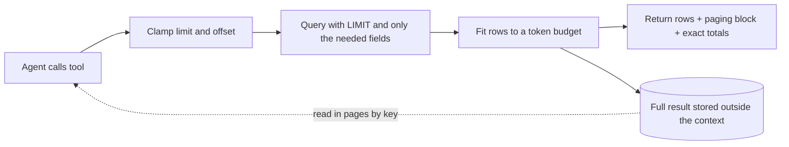

<!-- TODO before publishing: remove `published: false`, add header image, re-read the "What I haven't proven" section. -->

{:refdef: style="text-align: center;"}
{: loading="lazy"}
{: refdef}

---

> _Disclaimer: AI-assisted editing and structure. The incident, technical decisions, analysis, and opinions are mine. The domain, tables and code below are invented (an online store) so nothing here points at a real system. The measurements from the incident are real._

*(Quick note: most of the tables, schemas and database names below are made up. I could not use real data, so I invented them.)*

---

A user opened a chat with our AI agent, asked a follow-up question, and got an error two seconds later. Two seconds. That's not a timeout, that's the system slamming the door.

I went to the logs expecting a crash and found nothing of the sort. Turn one had run for 8 minutes 39 seconds, made 15 LLM calls and 24 tool calls, and finished with zero errors. Turn two died about two seconds after its model call started.

Then I looked at the size of the context: **463,976 tokens.**

*(Yes, that is a lot of tokens. No, I did not type that much.)*

Full disclosure: I can't prove what killed turn two. A replayed history the model rejected, Bedrock throttling and the context limit were all on my suspect list, and the logs didn't say which one did it. *(The logs also didn't say much about exceptions in general, but that's a different post and a different therapy session.)* What I could prove was that number, and where it came from.

---

## TL;DR

- One tool call that returned in **0.10 seconds** took a specialist agent's context from 5.5k to 186k tokens. Another agent went from 10k to as high as 224k after six parallel tool calls.
- My first guard counted **rows** (200 max). The rows weighed about 900 tokens each, so one call put roughly 180k tokens into context and the guard never fired. One turn then cost over **1 million input tokens**, because every later LLM call re-sends the whole context.
- Cap by **tokens, not rows**, and apply the cap *after* the page size so the cap always wins.
- What worked for me: shrink at the source, cap by tokens with a paging block, and store the full result outside the context.
- Don't let the model add up numbers. Return exact totals computed in code.
- My guard was opt-in per tool, which means it **fails open**. That is the weakest part of what I built and I'll own it below.
- I have not run a controlled before/after of the model's input tokens. The last section says exactly what I have and haven't proven.

---

## The Story


The setup: a multi-agent system built on [Google ADK](https://google.github.io/adk-docs/), running Claude on AWS Bedrock through LiteLLM. An orchestrator hands the turn to a specialist agent. The specialist calls tools, reads the results, and writes an answer back.

I pulled up the token metrics and found two things that made me put my coffee down:

- A specialist for order history went from **5.5k to 186k tokens after a single tool call that took 0.10 seconds**.
- A shipping specialist went from **10k to as high as 224k** after six parallel tool calls.

0.10 seconds. That's a fast tool. It's also a tool that returned a *lot* of rows, very quickly.

Nothing was slow. Nothing errored. Every row was correct. The tool did exactly what its docstring promised: "return the customer's orders". The customer just had hundreds of them, and I had never once asked myself what "all the orders" costs when the reader is a language model that re-reads everything on every call.

The wider logs told the same story. Over 7 days of production logs (counts only):

- **17 context failures** across **13 sessions**, all in one agent.
- First failure came on turn 1 for 6 sessions, turn 2 for 3, turn 3 for 2 and turn 4 for 2. "Turn" here means completed responses logged before the failure. I did not verify session start times.
- Context size at failure clustered near **1.4M** and **2.8M** tokens.

{:refdef: style="text-align: center;"}
{: loading="lazy"}
{: refdef}

---

## "But I Had a Guard!"

I did. I want that on the record. I had a helper that said: if a tool returns more than 200 rows, truncate and warn. Responsible adult behaviour.

The tool returned fewer than 200 rows. *(Famous last words: "it's capped at 200, what's the worst that could happen?")* Each row carried free-text notes and nested fields, about 900 tokens per row, so a single call was roughly 180k tokens sitting comfortably under a limit that only knew how to count rows. Even worse, the helper treated dict-shaped payloads as empty, so those never tripped it at all.

Then comes the part I hadn't thought through: **context is re-sent on every LLM call.** A fat tool result doesn't cost you once. It costs you again on every call after it, for the rest of the turn. That's how one turn ended up over a million input tokens.

I also assumed history compaction would rescue me. It doesn't. In my setup it trims old tool content but keeps the most recent events raw, so a huge result inside the retained window just sits there, untouched. Compaction is a late, lossy backstop. It is not a control.

---

## How ADK Holds the Context

Google ADK keeps each session as a list of **events**. A user message, a model reply, a tool call and a tool result are each one event. Every model call is built from the session's events, so a big tool result stays in the session until something removes it.

- The orchestrator picks which specialist gets the turn. The specialist's tool calls and results are written to the same session.
- A tool result is stored as a `function_response` event.
- Compaction adds a summary event. It records a start and end time for the range it covers. The raw events in that range stay in the database.

What I measured on production (counts only, names removed):

- The 8 newest compaction events each covered **2 to 35 raw events**. Their sessions kept **44 to 77 events** in total.
- In 3 of those sessions, I counted raw tool results inside the compacted range: **2, 0 and 10**.

What I read in the code but did not measure end to end: what the model sees after compaction. Treat that as unverified.

The check I ran to see how much one time range holds. Table and column names are invented:

```sql
-- How many raw events fall inside one compaction range?
SELECT count(*)
FROM agent_events
WHERE app_name = 'support_app'
  AND user_id = 'user-123'
  AND session_id = 'sess-456'
  AND event_time BETWEEN 1729670400 AND 1729756800;
```

And the check that showed the cost problem. Same invented names:

```sql
EXPLAIN
SELECT count(*)
FROM agent_events
WHERE event_time >= now() - interval '30 days';
```

On production, a 30-day range like this had **no index to use**. The plan was a parallel sequential scan with cost **228,490**. Lookups by app, user and session used a composite index. A time-only range had no index at all. Check the plan before you trust a range query.

## The Three Layers



### Layer 1: shrink at the source

The cheapest token is the one you never fetch. So:

- `LIMIT` to the most recent N rows.
- Return only the fields the model needs. The free-text notes and nested blobs were most of the weight, and the model never needed them to answer anything.
- Return the true total in the summary, so "showing 17 of 791" is a fact and not a guess.

And **compute totals in code.** I watched an agent summarise a table of 10 items that sum to 620 and confidently report 700. Twice. Same answer both runs. Re-reading the table didn't help. So now the tool returns the exact count, sum and group-by totals, and the prompt says: quote the totals, never add amounts yourself. (LLMs are brilliant at many things. Arithmetic on a markdown table is not one of them.)

### Layer 2: cap by tokens, not rows

Size the payload by what it actually costs: serialised length divided by a characters-per-token ratio. Here's a small version on an invented store. I ran it against a fake repository with 791 fat rows to make sure it does what I'm about to claim.

```python
import json
import math

CHARS_PER_TOKEN = 3.0  # rough; calibrate against the provider's usage numbers
TOOL_OUTPUT_MAX_TOKENS = 16_000  # a starting value, not a tuned one
PAGE_DEFAULT, PAGE_MAX, OFFSET_MAX = 50, 200, 10_000


def estimate_tokens(payload) -> int:
    return math.ceil(len(json.dumps(payload, default=str)) / CHARS_PER_TOKEN)


def resolve_page(limit, offset):
    for name, value in (("limit", limit), ("offset", offset)):
        if value is not None and type(value) is not int:
            raise ValueError(f"{name} must be an integer")
    limit = PAGE_DEFAULT if limit is None else limit
    offset = 0 if offset is None else offset
    if limit < 1:
        raise ValueError("limit must be at least 1")
    if not 0 <= offset <= OFFSET_MAX:
        raise ValueError(f"offset must be between 0 and {OFFSET_MAX}")
    return min(limit, PAGE_MAX), offset


def fit_rows(rows, budget_tokens) -> int:
    used = 0
    for index, row in enumerate(rows):
        used += estimate_tokens(row)
        if used > budget_tokens:
            return index
    return len(rows)


def page_info(total, returned, offset, truncated) -> dict:
    return {
        "total": total,
        "returned": returned,
        "offset": offset,
        "truncated": truncated,
        "next_offset": offset + returned if truncated else None,
    }


async def get_order_history(customer_id, limit=None, offset=None) -> dict:
    """Return the customer's orders, newest first. Page with `offset` when `truncated` is true."""
    limit, offset = resolve_page(limit, offset)
    rows, total = await orders_repo.fetch_page(customer_id, limit=limit, offset=offset)
    kept = rows[: max(1, fit_rows(rows, TOOL_OUTPUT_MAX_TOKENS))]
    truncated = offset + len(kept) < total
    return {"status": "success", "summary": page_info(total, len(kept), offset, truncated), "data": kept}
```

On 791 fat rows it returned the first 17 (about 15.5k tokens) with `truncated: True` and `next_offset: 17`. The next call started at row 17, exactly where it should. A small table came back whole, no paging noise. Satisfying.

Four decisions in there matter more than the arithmetic:

1. **The cap runs after the page size, so the cap wins.** A model that asks for `limit=1000000` gets 200 at most, and then the token fit trims it further.
2. **Model-supplied arguments get clamped, and bad ones fail loudly.** Negative offset or zero limit? Error. Never a silent fallback to some default. *A guard the caller can override is not a guard.*
3. **The paging block tells the model the data was cut** (`truncated`, `total`, `next_offset`). The prompt then tells it to say so to the user, and to page only if the question really needs more.
4. **Cap off must behave exactly like before.** I kept a switch so I can compare behaviour with and without it. Remember that, it comes back later.

### Layer 3: store the full result outside the context

The model doesn't need 791 rows. It needs the first page, the total, and a way to ask for more. So the full result goes into a session store under a key, and the model gets a page plus that key. A second tool, `read_stored_data(key, limit, offset)`, reads the following pages, with the same clamps.

One more trick for flat tables: rendering rows as a markdown table cost about 2.5x fewer tokens per row than JSON on one of our tools. Measured, but on one shape of data, so don't treat it as gospel. The catch is that anything downstream expecting a list will break, so I only use it on flat rows, one scalar per column.

---

## Gotchas (a.k.a. the stuff that bit me)

1. **My own metering lied.** The token estimate I logged counted text parts only, so on tool-heavy calls it read close to zero. I was debugging a context problem with a gauge that couldn't see the context. *(Ah yes, the classic "the dashboard is green because the dashboard is blind".)* Fix the gauge first: log the real size per call, split by role.
2. **Concurrent count queries overflowed the connection pool.** A page query plus a count query for every parent record, all at once, ate a pool of 10 connections (and 10 more waiting) and tripped its circuit breaker. Run the second round after the first.
3. **One row bigger than the budget.** If the very first row exceeds the budget, `fit_rows` returns 0 and `next_offset` points back at the same row. The model loops. My version returns at least one row. A better version would also trim the fat fields inside that row.
4. **Summaries and side lists count too.** If a customer has hundreds of saved addresses, a neat little "list of addresses" in your summary can eat the whole budget by itself. Bound them, and report the true total.
5. **A stale comment hid the real limit.** A config comment said the cap was off. The value next to it was a 16,000-token cap. Trust the value, not the comment.
6. **A guard that was switched off.** Our query audit logged problems but its blocking was off, so nothing was ever stopped. Also, by reading the code, I found one read tool with no cap on its result. Both are fail-open. Check that each guard is actually on.

---

## What I Haven't Proven

This is the section I'd want to read, so here it is, no varnish.

- **No controlled before/after.** I measured the growth in the incident, and I can see the cap firing in the logs. What I haven't done is re-run the same session with the cap off and then on and compared the model's input tokens per call. "The cap shrinks what enters the context" is supported. "Context overflow is gone" is not.
- **I still see context-window errors in the logs.** Caps only cover the tools that opted in. A tool that didn't opt in can still flood the context.
- **The numbers are starting values.** The 3.0 characters per token and the 16,000-token budget are estimates. They should come from measurements against the provider's real usage numbers, and mine aren't tuned yet.
- **I can't prove the cause of the original failure.** I proved the size, and I traced where it grew. That's it.

And the weakest design choice, which I mentioned at the top: the opt-in. *Every tool author has to remember to turn the cap on.* A guard that depends on remembering fails open, which is precisely the thing I tell other people not to do. If I did it again, the cap would be on by default at the one place every tool call passes through, and a tool would opt out only with a written reason. Lesson learned, the slightly embarrassing way.

---

## Checklist: a new tool that returns rows or lists

1. Fetch less at the source: `LIMIT`, only the fields the model needs, no raw free text.
2. Return the true total and exact aggregates, computed in code.
3. Cap by estimated tokens, not rows, and apply it after the page size.
4. Clamp `limit` and `offset`. Reject bad values and reversed date ranges with a clear error.
5. Return `truncated`, `total` and `next_offset`, and tell the model in the prompt to say so.
6. Store the full result outside the context and let the model page by key.
7. Log every time the cap fires: tool name, estimated tokens, rows returned, total. Never log the rows.
8. Add the opposite test for each guard: over the cap, under the cap, clamped limit, bad offset, cap off.

---

## Closing

Tools that return fast are not tools that return small. The agent can't tell the difference, and neither can your latency dashboard.

If you're running tool-calling agents in production, go open the metrics for whichever agent's context grows the fastest and find the single tool call that moved it. I'd bet money it took less than a second.
